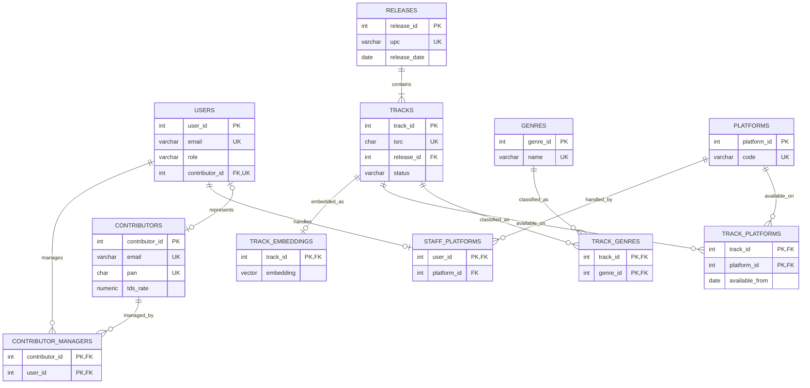
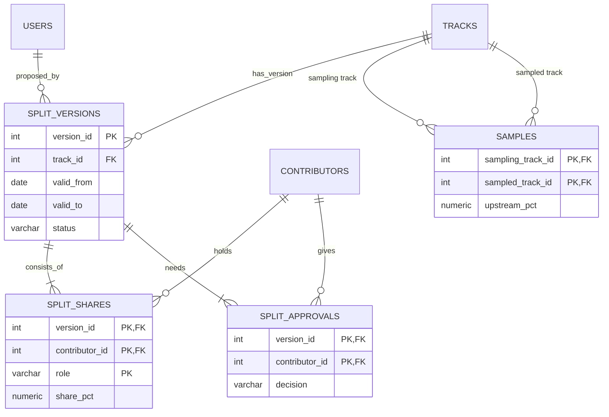
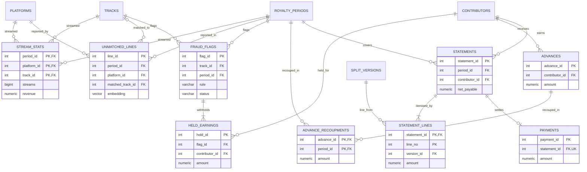

# 1. ER Model

This document describes the conceptual design: entity sets, relationship sets, cardinality and
participation constraints, and how the ER model is reduced to a relational schema.
The resulting tables are listed in [02-relational-schema.md](02-relational-schema.md) and every column is
described in [03-data-dictionary.md](03-data-dictionary.md).

## 1.1 Entity sets

### Strong entity sets

| Entity | Key | Main attributes | Notes |
|---|---|---|---|
| **Contributor** | contributor_id (natural keys: email, PAN) | legal_name, stage_name, email, pan, tds_rate | A person who earns royalties |
| **User** | user_id (natural key: email) | email, password_hash, full_name, role, is_active | A login. Specialised by `role` into Admin, Staff, Contributor |
| **Release** | release_id (natural key: UPC) | upc, title, release_type, release_date | Single, EP or album |
| **Track** | track_id (natural key: ISRC) | isrc, title, duration_sec, status | A recording |
| **Genre** | genre_id | name | |
| **Platform** | platform_id | code, name | Spotify, YouTube Music, JioSaavn … |
| **RoyaltyPeriod** | period_id | period_start, period_end, status | One calendar month |
| **SplitVersion** | version_id | valid_from, valid_to, status | One version of a track's ownership split |
| **Advance** | advance_id | amount, issued_on, note | Money paid to a contributor ahead of earnings |
| **Statement** | statement_id | gross_earned, held_amount, released_amount, recouped_amount, tds_rate_applied, tds_amount, net_payable | A contributor's earnings for one period |
| **Payment** | payment_id | amount, paid_at, reference | |
| **FraudFlag** | flag_id | rule, observed_value, threshold_value, status, note | Raised by the fraud-detection queries |
| **HeldEarning** | hold_id | amount, status | Money withheld because of a fraud flag |
| **UnmatchedLine** | line_id | raw_title, raw_artist, streams, revenue, status | A report line that couldn't be tied to a track by ISRC |
| **AuditEntry** | audit_id | table_name, operation, old_row, new_row, changed_by, changed_at | Written only by triggers; deliberately not linked by FKs so it outlives the rows it describes |

### Weak entity sets

| Weak entity | Identifying owner | Partial key | Why weak |
|---|---|---|---|
| **SplitShare** | SplitVersion | (contributor_id, role) | A share means nothing outside its version |
| **StatementLine** | Statement | line_no | A line exists only inside its statement |
| **TrackEmbedding** | Track | — (1:1 with owner) | The vector describes exactly one track and is deleted with it |

### Attribute kinds worth noting

| Kind | Example | How it is handled |
|---|---|---|
| Composite | A royalty period's date range (`period_start`, `period_end`) | Stored as separate atomic columns |
| Multivalued | Track → genres, Track → platforms it is available on | Separate tables `track_genres`, `track_platforms` (also needed for 4NF, see [04-normalization.md](04-normalization.md)) |
| Derived | Contributor's outstanding advance balance | **Not stored.** Computed by a view from `advances` and `advance_recoupments` |
| Derived | Track's full-text `search_vector` | Stored as a generated column so it can be indexed |
| Snapshot | `tds_rate_applied` on a statement | Stored on purpose: the contributor's rate may change later, but a paid statement must not |

## 1.2 Relationship sets

| Relationship | Between | Cardinality | Participation | Attributes |
|---|---|---|---|---|
| represents | User — Contributor | 1 : 1 | partial on both sides (admins/staff have no contributor; a contributor may not have a login yet) | |
| contains | Release — Track | 1 : N | total on Track | |
| classified_as | Track — Genre | M : N | partial | |
| available_on | Track — Platform | M : N | partial | available_from |
| handles | Staff User — Platform | N : 1 | partial | |
| managed_by | Contributor — Staff User | M : N | partial | |
| has_version | Track — SplitVersion | 1 : N | total on SplitVersion | |
| consists_of *(identifying)* | SplitVersion — SplitShare | 1 : N | total on SplitShare | |
| holds | Contributor — SplitShare | 1 : N | total on SplitShare | |
| approves | Contributor — SplitVersion | M : N | partial | decision, decided_at |
| proposed_by | User — SplitVersion | 1 : N | total on SplitVersion | |
| **samples** *(recursive)* | Track (sampling) — Track (sampled) | M : N | partial | upstream_pct, cleared_on |
| **streamed** *(ternary)* | Track — Platform — RoyaltyPeriod | M : N : P | partial | streams, revenue, source_report_id |
| reported_in | UnmatchedLine — RoyaltyPeriod, UnmatchedLine — Platform | N : 1 each | total on UnmatchedLine | |
| matched_to | UnmatchedLine — Track | N : 1 | partial (only once confirmed) | matched_by, matched_at |
| embedded_as *(identifying)* | Track — TrackEmbedding | 1 : 1 | total on TrackEmbedding | |
| flags | FraudFlag — Track, — RoyaltyPeriod | N : 1 each | total on FraudFlag | |
| flags_platform | FraudFlag — Platform | N : 1 | partial (only for the concentration rule) | |
| reviewed_by | FraudFlag — User | N : 1 | partial | reviewed_at |
| withholds | FraudFlag — HeldEarning | 1 : N | total on HeldEarning | |
| held_for | HeldEarning — Contributor | N : 1 | total on HeldEarning | |
| earned_in / released_in | HeldEarning — RoyaltyPeriod | N : 1 each | total / partial | |
| receives | Contributor — Advance | 1 : N | total on Advance | |
| recouped_in | Advance — RoyaltyPeriod | M : N | partial | amount |
| earns | Contributor — Statement | 1 : N | total on Statement | |
| covers | RoyaltyPeriod — Statement | 1 : N | total on Statement | |
| itemised_by *(identifying)* | Statement — StatementLine | 1 : N | total on StatementLine | |
| line_from | StatementLine — SplitVersion | N : 1 | total on StatementLine | role |
| via | StatementLine — Track | N : 1 | partial (only for sample-chain earnings) | |
| settles | Payment — Statement | 1 : 1 | total on Payment, partial on Statement (a zero-net statement has no payment) | |
| processed_by | RoyaltyPeriod — User | N : 1 | partial | processed_at |

Two relationships are worth pointing out in the viva:

- **samples** is a *recursive* relationship: the same entity set (Track) plays two roles, *sampling* and
  *sampled*. Chains of it (A ← B ← C) are walked with a recursive CTE in SQL and a variable-length path in Neo4j.
- **streamed** is a genuine *ternary* relationship. "Track T had 1,20,000 streams on Spotify in
  September" cannot be split into binary relationships without losing information: knowing T was on
  Spotify, T streamed in September and Spotify reported in September does not tell you the count.

## 1.3 ER diagrams

Crow's-foot notation (`||` exactly one, `o|` zero or one, `|{` one or more, `o{` zero or more).
For readability the model is split into three subject areas; entities that appear in more than one
diagram are the same entity. Only key attributes are shown. All attributes are in the data dictionary.

### (a) Catalogue and people

### (b) Ownership: split versions, approvals and samples

### (c) Money: streams, fraud, matching and payouts

## 1.4 Reducing the ER model to a relational schema

| ER construct | Mapping rule | Applied to |
|---|---|---|
| Strong entity set | One table; entity key becomes the primary key; natural keys kept as `UNIQUE` | contributors, users, releases, tracks, genres, platforms, royalty_periods, split_versions, advances, statements, payments, fraud_flags, held_earnings, unmatched_lines, audit_log |
| Weak entity set | One table; PK = owner's PK + partial key; FK to owner with `ON DELETE CASCADE` | split_shares (version_id, contributor_id, role), statement_lines (statement_id, line_no), track_embeddings (track_id) |
| 1 : N relationship | FK on the N side; `NOT NULL` when participation is total | tracks.release_id, split_versions.track_id, advances.contributor_id, statements.period_id … |
| 1 : 1 relationship | FK + `UNIQUE` on the side with partial participation | users.contributor_id (UNIQUE, NULL allowed), payments.statement_id (UNIQUE, NOT NULL) |
| N : 1 with an extra key-like constraint | FK on the N side, with the N side's PK as the table key | staff_platforms (user_id PK → platform_id) |
| M : N relationship | Separate table; PK = both FKs; relationship attributes become columns | track_genres, track_platforms, contributor_managers, split_approvals, advance_recoupments |
| Recursive M : N | Separate table with two FKs to the same table, named by role | samples (sampling_track_id, sampled_track_id) |
| Ternary relationship | Separate table; PK = all three FKs | stream_stats (period_id, platform_id, track_id) |
| Multivalued attribute | Separate table keyed by owner + value | track_genres, track_platforms |
| Derived attribute | Not stored; provided by a view | advance balance → `v_advance_balances` |
| Specialisation (User by role) | Single table with a `role` discriminator and a `CHECK` that only contributor users link to a contributor | users.role, users.contributor_id |

**Surrogate vs natural keys.** Every natural identifier from the industry (ISRC for tracks, UPC for
releases, email and PAN for contributors) is kept as a `UNIQUE NOT NULL` candidate key and validated with
a `CHECK`. Small integer surrogate keys are used as primary keys so foreign keys stay compact and an ISRC
correction doesn't cascade through lakhs of `stream_stats` rows. Because each surrogate maps one-to-one
to its natural key, this doesn't change any normal-form analysis.
