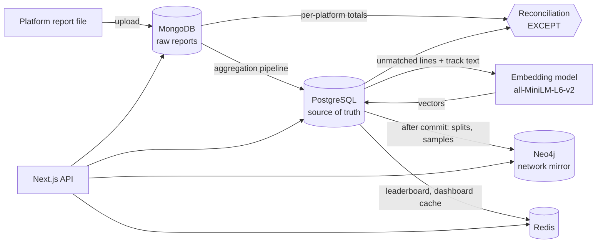
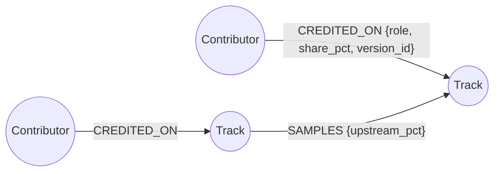

# 5. MongoDB, Neo4j, pgvector and Redis models

PostgreSQL is the **source of truth** for everything involving money or ownership. Each other store
holds one kind of data that its paradigm fits better, and none of them is ever needed to compute a payout.



Code: `web/src/lib/db/*` (one client per store) and `web/src/lib/stores/*` (reports, embeddings, graph,
cache). `bash db/setup_all.sh` rebuilds all four stores; `npm run stores -- <command>` in `web/` runs
each piece on its own (see `web/scripts/stores.ts`).

---

## 5.1 MongoDB: raw platform reports

**Why a document store:** every platform sends a differently shaped report. Forcing them into one SQL
table means either dozens of nullable columns or throwing the original away. We keep every line exactly
as received (for audit and re-processing) and let an aggregation pipeline produce the uniform shape
Postgres needs.

Database `royalty_raw`, two collections with `$jsonSchema` validators (`ensureMongoCollections()`).

### Collection `reports`: one document per uploaded file

```json
{
  "_id": ObjectId("…"),
  "platform": "SPOTIFY",
  "period_start": ISODate("2026-10-01"),
  "file_name": "spotify_2026_10.csv",
  "uploaded_by": 4,
  "uploaded_at": ISODate("…"),
  "status": "loaded",                       // uploaded | loaded | failed
  "line_count": 510,
  "declared_totals": { "streams": NumberLong(9456364), "revenue": NumberDecimal("810034.82") },
  "loaded": { "matched": 508, "unmatched": 2 }
}
```

`declared_totals` is what the platform *says* the file adds up to (Spotify's `TOTAL` footer row,
YouTube's `summary` block; JioSaavn sends none, so it is `null`). Money is stored as `Decimal128`, never as
a binary float.

### Collection `report_lines`: one document per line, the original under `raw`

The same fact, three shapes (from `db/mongo/sample_reports/`):

```json
{ "report_id": ObjectId("…"), "platform": "SPOTIFY", "line_no": 1,
  "raw": { "isrc": "INM0R2500003", "track_name": "Petrichor", "artist_name": "Aarav",
           "streams": "187641", "net_revenue_inr": "16639.32" } }

{ "report_id": ObjectId("…"), "platform": "YT_MUSIC", "line_no": 259,
  "raw": { "asset": { "title": "Terrace Nights (Official Audio)", "isrc": null },
           "channel": "Arjun N - Topic",
           "metrics": { "views": 1406815, "revenue": 63149.56 } } }

{ "report_id": ObjectId("…"), "platform": "JIOSAAVN", "line_no": 341,
  "raw": { "ISRC": "", "Song": "Monsoon Letters - Lofi Flip", "Artists": "Kabir Beats|Aarav",
           "Plays": "505072", "Amount": "28954.12" } }
```

The differences are real format differences: CSV cells arrive as **strings**, JSON values as
**numbers**; field names and nesting differ; JioSaavn packs artists into one `|`-separated cell; a missing
ISRC is `null` in JSON but an empty string in CSV.

Validator on `report_lines` (`raw` is deliberately left free-form):

```js
{ $jsonSchema: { bsonType: "object", required: ["report_id", "platform", "line_no", "raw"],
  properties: { report_id: { bsonType: "objectId" },
                platform:  { enum: ["SPOTIFY", "YT_MUSIC", "JIOSAAVN", "APPLE_MUSIC", "GAANA"] },
                line_no:   { bsonType: "int", minimum: 1 },
                raw:       { bsonType: "object" } } } }
```

Indexes: `report_lines {report_id: 1, line_no: 1}` (unique), `reports {platform: 1, period_start: 1}`.

### Aggregation pipeline: normalise a report (`normalizeReportPipeline`)

```js
[
  { $match: { report_id: { $in: [REPORT_ID] } } },
  { $project: {
      platform: 1,
      isrc:   { $switch: { branches: [
                  { case: { $eq: ["$platform", "SPOTIFY"] },  then: "$raw.isrc" },
                  { case: { $eq: ["$platform", "YT_MUSIC"] }, then: "$raw.asset.isrc" },
                  { case: { $eq: ["$platform", "JIOSAAVN"] }, then: "$raw.ISRC" } ], default: null } },
      title:  { $ifNull: ["$raw.track_name", "$raw.asset.title", "$raw.Song"] },
      artist: { $ifNull: ["$raw.artist_name", "$raw.channel",
                 { $reduce: { input: { $split: ["$raw.Artists", "|"] }, initialValue: "",     // "A|B" -> "A, B"
                              in: { $concat: ["$$value", { $cond: [{ $eq: ["$$value", ""] }, "", ", "] },
                                              { $trim: { input: "$$this" } }] } } }] },
      streams: { $convert: { input: { $ifNull: ["$raw.streams", "$raw.metrics.views", "$raw.Plays"] },
                             to: "long", onError: null, onNull: null } },
      revenue: { $convert: { input: { $ifNull: ["$raw.net_revenue_inr", "$raw.metrics.revenue", "$raw.Amount"] },
                             to: "decimal", onError: null, onNull: null } } } },
  { $set: { isrc: { $let: { vars: { i: { $trim: { input: { $ifNull: ["$isrc", ""] } } } },          // "" -> null
                            in: { $cond: [{ $eq: ["$$i", ""] }, null, { $toUpper: "$$i" }] } } } } },
  { $group: { _id: { platform: "$platform", key: { $ifNull: ["$isrc", { title: "$title", artist: "$artist" }] } },
              isrc: { $first: "$isrc" }, title: { $first: "$title" }, artist: { $first: "$artist" },
              streams: { $sum: "$streams" }, revenue: { $sum: "$revenue" }, lines: { $sum: 1 },
              bad_lines: { $sum: { $cond: [{ $or: [{ $eq: ["$streams", null] }, { $eq: ["$revenue", null] }] }, 1, 0] } } } }
]
```

A line whose numbers can't be converted makes the whole report `failed`; nothing reaches Postgres.

Then, in **one Postgres transaction** (as the uploading staff member, so it is audited and checked
against `app_staff`'s privileges):

- rows whose ISRC is in the catalogue are upserted into `stream_stats` (`INSERT … SELECT FROM unnest(…)
  ON CONFLICT DO UPDATE`). The report is authoritative for its platform and month.
- everything else (no ISRC, or an ISRC not in the catalogue) becomes an `unmatched_lines` row for vector
  matching (§5.3). A mistyped ISRC is kept in the title, e.g. `Rain Cypher [ISRC INM0R25000O9 not in catalogue]`.

Only after Postgres commits is the Mongo report marked `loaded`. If Postgres fails, the report stays
`uploaded` and can simply be loaded again.

October 2026 sample load:

| File | Lines | Loaded as tracks | Unmatched lines |
|---|---|---|---|
| `spotify_2026_10.csv` | 510 | 508 | 2 |
| `yt_music_2026_10.json` | 262 | 258 | 4 |
| `jiosaavn_2026_10.csv` | 344 | 340 | 4 |

### Reconciliation (X1): declared vs received vs loaded

`reconcilePeriod()` compares three totals per platform:

- **declared**: the platform's own footer or summary;
- **received**: what the lines in MongoDB add up to (same `$project` stages, then `$group` by platform);
- **loaded**: what reached Postgres (`stream_stats` from those reports plus their not-yet-matched lines).

The Mongo totals go into a temporary table, and Postgres finds the platforms that didn't load fully with a
set operation:

```sql
SELECT platform_code, streams, round(revenue, 2) FROM tmp_mongo_totals
EXCEPT
SELECT p.code, sum(x.streams)::bigint, round(sum(x.revenue), 2)
FROM (SELECT platform_id, streams, revenue FROM stream_stats
      WHERE source_report_id = ANY($1)
      UNION ALL
      SELECT platform_id, streams, revenue FROM unmatched_lines
      WHERE source_report_id = ANY($1) AND status <> 'matched') x
JOIN platforms p USING (platform_id)
GROUP BY p.code;
```

October 2026 result. The Spotify file is "truncated": its footer counts a line the file doesn't contain.

| Platform | Declared | Received (MongoDB) | Loaded (Postgres) | Status |
|---|---|---|---|---|
| JIOSAAVN | — | 6,551,669 / ₹3,89,561.76 | 6,551,669 / ₹3,89,561.76 | ok |
| SPOTIFY | 9,456,364 / ₹8,10,034.82 | 9,444,019 / ₹8,08,985.49 | 9,444,019 / ₹8,08,985.49 | **declared ≠ received** |
| YT_MUSIC | 5,242,237 / ₹2,35,586.27 | 5,242,237 / ₹2,35,586.27 | 5,242,237 / ₹2,35,586.27 | ok |

---

## 5.2 Neo4j: sample and collaboration network (F2)

**Why a graph database:** questions like "how is producer X connected to artist Y?" or "which tracks are
sampled, directly or indirectly, the most?" are path searches of unknown depth. In SQL each extra hop is
another self-join or another level of a recursive CTE; in a graph database it is a variable-length
pattern. The graph is a **read-only mirror**: money is always computed in Postgres.

### Graph model



| Element | Properties | Source in Postgres |
|---|---|---|
| `(:Contributor)` | contributor_id, name | `contributors` with at least one current credit |
| `(:Track)` | track_id, isrc, title | `tracks` |
| `[:CREDITED_ON]` | role, share_pct, version_id | `v_current_splits` (each track's **active** version) |
| `[:SAMPLES]` (sampling → sampled) | upstream_pct | `samples` |

Uniqueness constraints on `Contributor.contributor_id` and `Track.track_id`. Size after a rebuild:
**3,912 nodes, 10,500 relationships**.

**Sync** (`web/src/lib/stores/graph.ts`): `rebuildGraph()` drops and reloads everything with batched
`UNWIND … MERGE`. `syncTrack(id)` replaces one track's edges after Postgres commits a split activation or
sample change. Ids are passed through `toInteger()` because the JavaScript driver sends numbers as floats.

### Example queries (results from the demo data)

```cypher
// Shortest connection between two contributors
MATCH (a:Contributor {contributor_id: $a}), (b:Contributor {contributor_id: $b}),
      p = shortestPath((a)-[:CREDITED_ON|SAMPLES*..10]-(b))
RETURN p;
```

Tara → Leela Krishnan, 5 hops: *Tara — Rain Cypher — Monsoon Letters (Lofi Flip) — Monsoon Letters —
Raag Megh (Revival) — Leela Krishnan*. Two people who never worked together, linked by a sample chain.

```cypher
// Most-sampled tracks, counting indirect samples
MATCH p = (d:Track)-[:SAMPLES*1..]->(t:Track)
RETURN t.title, count(DISTINCT d) AS sampled_by, max(length(p)) AS max_depth
ORDER BY sampled_by DESC;
```

Raag Megh (Revival) is sampled by 3 tracks (up to 3 hops away), Monsoon Letters by 2, the Lofi Flip by 1.
More queries for the Neo4j Browser are in `db/neo4j/queries.cypher`.

### Same question in SQL and Cypher (viva comparison)

"Every track upstream of Rain Cypher, with how many hops away it is":

```sql
WITH RECURSIVE upstream(track_id, depth, path) AS (
    SELECT sampled_track_id, 1, ARRAY[sampling_track_id, sampled_track_id]
    FROM samples WHERE sampling_track_id = $1
  UNION ALL
    SELECT s.sampled_track_id, u.depth + 1, u.path || s.sampled_track_id
    FROM samples s JOIN upstream u ON s.sampling_track_id = u.track_id
    WHERE s.sampled_track_id <> ALL (u.path)          -- cycle guard
)
SELECT t.title, MIN(u.depth) AS hops
FROM upstream u JOIN tracks t USING (track_id)
GROUP BY t.title ORDER BY hops;
```

```cypher
MATCH p = (:Track {track_id: $id})-[:SAMPLES*1..]->(t:Track)
RETURN t.title, min(length(p)) AS hops ORDER BY hops;
```

Both return Monsoon Letters (Lofi Flip) 1, Monsoon Letters 2, Raag Megh (Revival) 3.

---

## 5.3 pgvector: matching unmatched royalties (F4)

**Why vectors, and why inside Postgres:** platform titles drift from the catalogue: *"Monsoon Letters -
Lofi Flip"*, *"(Official Audio)"*, *"Arjun N - Topic"*, typos like *"Local Train Dreamz"*. Exact matching,
`LIKE` and even full-text search miss many of these. Sentence embeddings place texts with similar meaning
close together. Keeping the vectors in Postgres (vector search *with a relational DB*) means a match joins
straight back to `tracks`, `split_versions` and `stream_stats` in one query.

| Question | Answer |
|---|---|
| What is embedded | Tracks: `title — performer names` (stage names of the active split's artists; everyone credited if it has no artist role). Unmatched lines: `raw_title — raw_artist` |
| Model | `all-MiniLM-L6-v2` (sentence-transformers, 8-bit quantised ONNX), run locally in Node with `@huggingface/transformers`. About 23 MB, downloaded once to `web/.cache/`; no API key, no data leaves the machine |
| Dimensions | 384, mean-pooled and L2-normalised |
| Storage | `track_embeddings.embedding VECTOR(384)`, `unmatched_lines.embedding VECTOR(384)` |
| Index | HNSW, `vector_cosine_ops` |
| Similarity metric | Cosine. pgvector's `<=>` returns cosine **distance**; similarity = 1 − distance |
| When computed | Tracks: whenever their text changes (re-embedding is skipped otherwise). Lines: right after a report loads. 3,500 tracks + 10 lines take about 10 s on a laptop CPU |

### Retrieval

```sql
SET LOCAL hnsw.ef_search = 400;
SELECT t.track_id, t.isrc, t.title, e.source_text,
       round((1 - (e.embedding <=> u.embedding))::numeric, 4) AS similarity
FROM unmatched_lines u
CROSS JOIN LATERAL (
    SELECT track_id, embedding, source_text FROM track_embeddings
    ORDER BY embedding <=> u.embedding        -- nearest neighbours via the HNSW index
    LIMIT 5
) AS e
JOIN tracks t USING (track_id)
WHERE u.line_id = $1
ORDER BY similarity DESC;
```

| Similarity | UI treatment |
|---|---|
| ≥ 0.85 | "likely match", one click to confirm |
| 0.60 – 0.85 | "possible"; staff pick from the candidates |
| < 0.60 | "no good match"; search manually or write the line off |

Confirming (`confirm_unmatched_line()`) is one transaction: the line becomes `matched` and its streams and
revenue are upserted into `stream_stats`. Nothing is ever assigned automatically.

### Results on the October 2026 sample reports

| Unmatched line | Top suggestion | Similarity | Correct? |
|---|---|---|---|
| Monsoon Letters - Lofi Flip — Kabir Beats, Aarav | Monsoon Letters (Lofi Flip) | 0.984 likely | ✓ |
| Raag Megh Revival — Leela Krishnan, Vik | Raag Megh (Revival) | 0.968 likely | ✓ |
| Waiting Stars (Slowed + Reverb) — Advait Live | Waiting Stars | 0.856 likely | ✓ |
| Local Train Dreamz — Zoya Khan | Local Train Dreams | 0.833 possible | ✓ |
| Neon Chai (From "City Lights") — ZOYA, RoGu | Neon Chai | 0.826 possible | ✓ |
| Rain Cypher [mistyped ISRC] — Arjun N, Tara | Rain Cypher | 0.793 possible | ✓ |
| Chai Pe Charcha (Lyric Video) — Meera - Topic | Chai Pe Charcha | 0.748 possible | ✓ |
| Terrace Nights (Official Audio) — Arjun N - Topic | Terrace Nights | 0.722 possible | ✓ |
| Paper Boats \| Aarav \| Monsoon EP — Monsoon Records | Paper Boats | 0.679 possible | ✓ |
| Diwali Mashup 2026 (Fan Upload) — DJ Random | (an unrelated track) | 0.541 weak | ✓ correctly not matched: not the label's track |

### Approximate vs exact search (a finding worth knowing)

HNSW is an **approximate** nearest-neighbour index. It explores `hnsw.ef_search` candidates per query
(default 40). With the default, the index's top result agreed with an exact sequential scan for only
**6 of the 10** lines. The handmade tracks were missed because thousands of near-identical generated titles
("Watching Stars (Remix)", …) crowd the graph. Measured recall@1 against exact search:

| `hnsw.ef_search` | 40 | 100 | 200 | 400 |
|---|---|---|---|---|
| Top-1 equals exact top-1 | 6/10 | 9/10 | 9/10 | **10/10** |

The table has only 3,500 rows, so the wider search costs a few milliseconds; `suggestMatches()` sets
`hnsw.ef_search = 400` for its transaction. The general lesson is the recall/latency trade-off: the more
candidates an approximate index explores, the closer it gets to an exact (sequential-scan) answer.

---

## 5.4 Redis: key-value layer (F5)

**Why a key-value store:** sessions, rate-limit counters and leaderboards are read on almost every
request, are tiny, and should simply expire. Redis gives O(1) lookups and native TTLs. None of this data
needs joins, constraints or more durability than "can be rebuilt" (`web/src/lib/stores/cache.ts`).

| Key pattern | Type | Value | TTL | Used for |
|---|---|---|---|---|
| `session:{token}` | Hash | user_id, role, contributor_id, created_at | 8 h, sliding | Login sessions. `token` is 32 random bytes in an `HttpOnly`, `Secure`, `SameSite=Lax` cookie |
| `user_sessions:{user_id}` | Set | that user's tokens | 8 h | Logging a user out everywhere at once (deactivation) |
| `ratelimit:login:{email}` | String (counter) | failed attempts | 15 min from first failure | `INCR` per failure; login blocked at 5 |
| `lb:streams:{period_id}` | Sorted set | member = track_id, score = streams | none (rebuilt after each load) | "Top tracks this period" via `ZREVRANGE … WITHSCORES` |
| `lb:titles` | Hash | track_id → title | none | Display names for the leaderboard |
| `cache:{name}` | String (JSON) | e.g. dashboard totals | set per use, e.g. 5 min | Cache-aside; deleted when a report loads or a payout runs |

Session creation is a `MULTI` transaction (hash + expiry + set membership together). Demo output
(`npm run stores -- redis`): after 5 failed logins an address is blocked for 900 s, and revoking a user's
sessions makes `getSession()` return `null` immediately.
