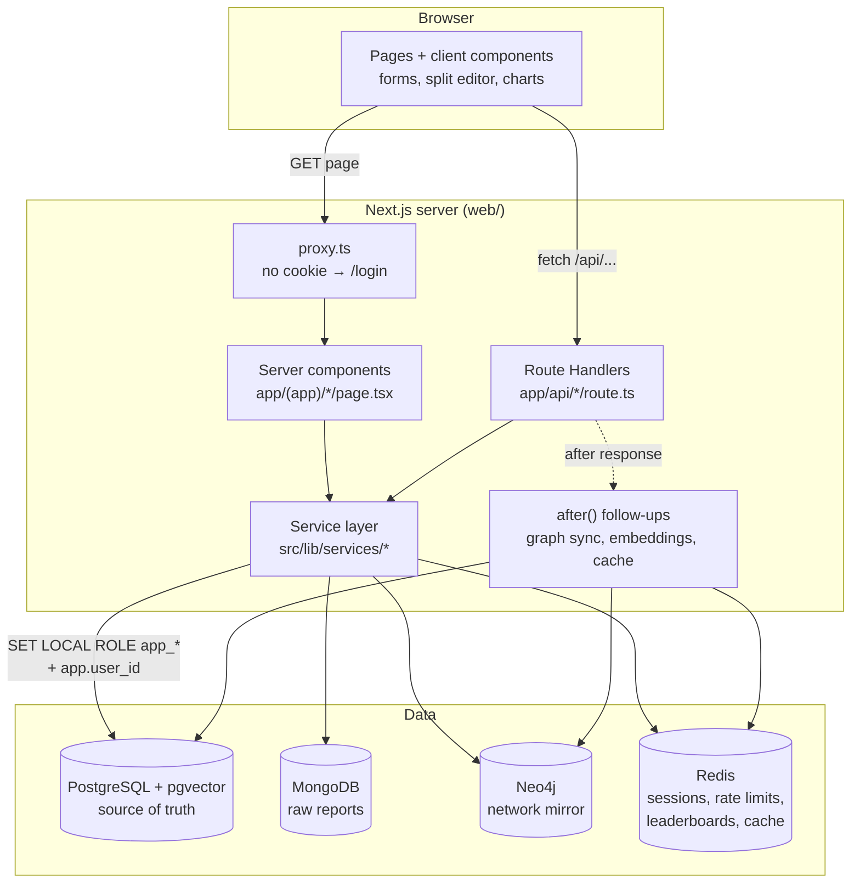

# 8. Web application and system architecture

Next.js 16 (App Router) in `web/`. Server components render every page on request; every change goes
through a Route Handler under `/api`; both call one service layer, which talks to the four databases.

## 8.1 System architecture

### One request, end to end (approving a split)

1. The browser sends `POST /api/splits/14/decision {"decision":"approved"}` with the `royalty_session` cookie.
2. `apiUser("contributor")` reads the token from the cookie and loads the session hash from **Redis**
   (`session:{token}`). There's no session → 401; the wrong role → 403.
3. `withTx(actor, …)` takes a pooled connection as `royalty_app` and runs `BEGIN`,
   `SET LOCAL ROLE app_contributor`, then `set_config('app.user_id', '<id>', true)`.
4. `SELECT approve_split(14, 'approved')` runs in **PostgreSQL**. The function finds the caller's own
   approval row, the R3 trigger notices it was the last one and activates the version, the old version is
   superseded, and audit triggers record every row with `changed_by`. Then `COMMIT`.
5. The handler returns `{"status":"active"}`. After the response is sent, `after()` re-syncs the track's
   edges in **Neo4j**, re-embeds its title text with **pgvector**, and clears the dashboard cache in **Redis**.

If any rule is broken, Postgres raises an error with a SQLSTATE. `src/lib/api.ts` turns it into an HTTP
status with the database's own message:

| SQLSTATE | Meaning | HTTP |
|---|---|---|
| 23502 / 23503 / 23505 / 23514 | not null / foreign key / unique / check or business rule | 422 |
| 55000 | wrong lifecycle state (e.g. "already paid") | 409 |
| 42501 | insufficient privilege (the DB role refused) | 403 |
| P0002 | not found | 404 |

## 8.2 Security

| Concern | How |
|---|---|
| Password storage | bcrypt hashes (pgcrypto `crypt()` / `gen_salt('bf')`); plain passwords are never stored |
| Password checking | `authenticate(email, password)` runs **inside Postgres** as `SECURITY DEFINER`; the hash never leaves the database. The `app_login` role can call that function and nothing else |
| Sessions | 32 random bytes in an `HttpOnly`, `SameSite=Lax` (and `Secure` in production) cookie; the session lives in Redis with an 8-hour sliding expiry |
| Brute force | Redis counter per email: 5 failures in 15 minutes lock the address |
| Revocation | Deactivating a user deletes all their Redis sessions at once (`user_sessions:{id}`) |
| Authorisation | Two layers: the app checks the role in every page and handler, and **every query runs as a database role** (`SET LOCAL ROLE`), so a bug in the app still can't read what the role can't |
| Contributors' data | `app_contributor` can read only the `v_my_*` views; it has no table access at all |
| Credentials | All in the root `.env` (git-ignored), loaded by `src/lib/env.ts`; `.env.example` holds placeholders |
| SQL injection | Every value is a bind parameter (`$1`); full-text queries are built as parameters too |
| Errors | Unknown server errors return a generic message; details are only logged on the server |

## 8.3 Pages

| Page | Roles | What it shows / does | Concepts on display |
|---|---|---|---|
| `/login` | everyone | Sign in | DB-side bcrypt check, Redis session + rate limit |
| `/` Dashboard | admin, staff | KPIs, revenue by platform (stacked bars), top tracks, work queues | Aggregates, Redis cache-aside, Redis sorted set |
| `/tracks` | admin, staff | Search + filters, 25 per page | Full-text prefix search (GIN), `count(*) OVER ()` pagination |
| `/tracks/[id]` | admin, staff | Current split, open proposal + approvals, split editor, **what-if simulator**, streams per month, sample chain, payouts, split history, fraud flags | F1, F2 (recursive CTE), X2 (SAVEPOINT + rollback) |
| `/contributors`, `/contributors/[id]` | admin, staff | Earnings, advances, statements, splits, account managers, collaborators | Views, Neo4j |
| `/network` | admin, staff | Shortest connection between two people; most-sampled tracks | Neo4j `shortestPath`, variable-length paths |
| `/reports` | admin, staff | Upload a platform file; 3-way reconciliation; uploaded files | MongoDB raw storage + aggregation, `EXCEPT` |
| `/unmatched` | admin, staff | Each unmatched line with its 3 nearest tracks; confirm or write off | pgvector cosine search (F4) |
| `/fraud` | admin | Flags grouped by track and month; clear (release) or confirm (forfeit) with a reason | Window functions (F3), triggers |
| `/payouts` | admin | Open / lock / unlock / pay each month; statements of a month | `process_payout` procedure, row locking |
| `/audit` | admin | Trigger-written history with old → new values per field | Audit triggers, append-only grants |
| `/users` | admin | Deactivate / reactivate (ends sessions) | Redis session revocation |
| `/me` | contributor | Own statements (with line detail), splits, advances; approve/reject proposals | `v_my_*` views, `approve_split()` |

## 8.4 API (Route Handlers)

| Method & path | Role | Calls |
|---|---|---|
| `POST /api/auth/login`, `POST /api/auth/logout` | anyone | `authenticate()`, Redis session |
| `GET /api/dashboard` | admin, staff | dashboard queries (cached) |
| `GET /api/tracks`, `GET /api/tracks/:id` | admin, staff | catalogue queries |
| `POST /api/tracks/:id/splits` | admin, staff | `propose_split_version()` |
| `POST /api/tracks/:id/simulate` | admin, staff, contributor on the track | two `process_payout` runs, always rolled back |
| `DELETE /api/splits/:id` | admin, staff | withdraw a proposal |
| `POST /api/splits/:id/decision` | contributor | `approve_split()` |
| `GET /api/reports`, `POST /api/reports` (multipart) | admin, staff | MongoDB store + aggregation + Postgres load |
| `GET /api/reconciliation?month=` | admin, staff | 3-way totals with `EXCEPT` |
| `POST /api/unmatched/:id` | admin, staff | `confirm_unmatched_line()` / `write_off_unmatched_line()` |
| `GET /api/periods`, `POST /api/periods` | admin | list; open next month |
| `POST /api/periods/:id` | admin | lock / unlock / pay (`CALL process_payout`) |
| `POST /api/fraud` | admin | review a track's flags for a month |
| `PATCH /api/users/:id` | admin | activate / deactivate |
| `GET /api/network` | admin, staff | Neo4j queries |

## 8.5 Verified behaviour (manual run against the demo data)

| Scenario | Result |
|---|---|
| Wrong password | 401 "Wrong email or password (4 attempts left)." |
| Each role on each page | Admin: all 200. Staff: 200, but `/payouts`, `/audit`, `/users` → redirect home. Contributor: only `/me`. No session → `/login` |
| Propose a 90% split | 422 "Split version … totals 90.00%, must be exactly 100%" (R1) |
| Propose from the 15th of a month | 422 "A split version must start on the 1st of a month" (R5) |
| Simulate a new split for Lofi Flip | Two real payouts in ~2 s; database unchanged afterwards |
| Upload to a paid month / wrong format / as a contributor / the same file twice | 409 / 422 with the parser's reason / 403 / 409 "already loaded" |
| Confirm an unmatched line twice | 200, then 409 "Line 8 is already matched" |
| Kabir approves the last pending share | Version becomes active; Neo4j and the embedding update in the background |
| A contributor decides on a split they're not on | 403 "You are not on split version 14" (from the database) |
| **Two "Pay September" clicks at the same moment** | One 200 (412 statements, ₹19.86 L held for fraud review); the other 409 "Period 12 (Sep 2026) has already been paid" |
| Review a flag without a reason | 422 |
| Deactivate a signed-in user | Their next request goes to `/login`; signing in again fails |
| Console errors across every page | None |

**Bug found by this pass and fixed in the database:** approving every row of a proposal in **one**
`UPDATE` made the AFTER-ROW trigger fire once per row after the statement, and each firing tried to
activate the version. `activate_split_version()` is now idempotent, and
`tests/02_business_rules_test.sql` covers the multi-row case.
